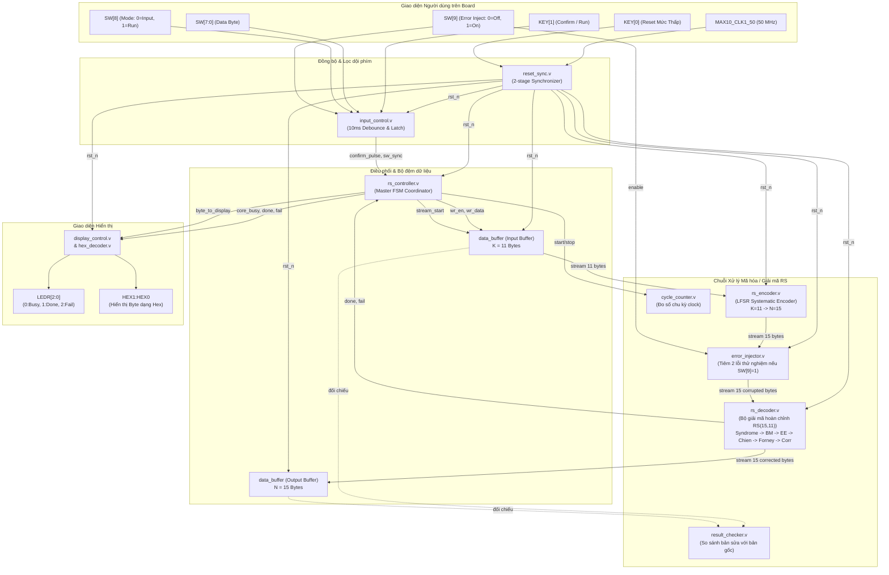
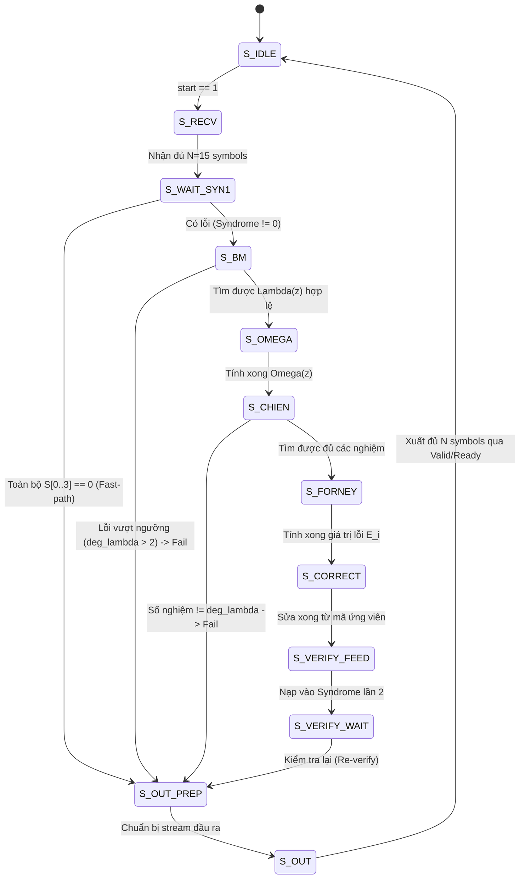

# Hệ thống Mã hóa & Giải mã Reed–Solomon RS(15,11) trên FPGA Terasic DE10-Lite

Dự án thiết kế và triển khai hoàn chỉnh hệ thống mã hóa và giải mã sửa sai **Reed–Solomon (RS)** trên trường Galois $\text{GF}(256)$ bằng ngôn ngữ **Verilog HDL**, chạy thực nghiệm trên kit phát triển **Terasic DE10-Lite** (chip FPGA **Intel MAX 10 `10M50DAF484C7G`**) và được kiểm chứng toàn diện qua **ModelSim / QuestaSim** cùng mô hình toán học tham chiếu **Python**.

---

## Mục lục
1. [Giới thiệu và Mục tiêu dự án](#1-giới-thiệu-và-mục-tiêu-dự-án)
2. [Thông số kỹ thuật chuẩn của hệ thống](#2-thông-số-kỹ-thuật-chuẩn-của-hệ-thống)
3. [Cấu trúc thư mục dự án](#3-cấu-trúc-thư-mục-dự-án)
4. [Kiến trúc hệ thống & Nguyên lý hoạt động](#4-kiến-trúc-hệ-thống--nguyên-lý-hoạt-động)
   - [4.1. Sơ đồ khối tổng thể](#41-sơ-đồ-khối-tổng-thể)
   - [4.2. Giao thức bắt tay luồng (Streaming Valid/Ready Handshake)](#42-giao-thức-bắt-tay-luồng-streaming-validready-handshake)
   - [4.3. Các module số học trường Galois GF(256)](#43-các-module-số-học-trường-galois-gf256)
   - [4.4. Bộ mã hóa Reed–Solomon (RS Encoder)](#44-bộ-mã-hóa-reedsolomon-rs-encoder)
   - [4.5. Chuỗi giải mã và sửa sai tự động (RS Decoder Chain)](#45-chuỗi-giải-mã-và-sửa-sai-tự-động-rs-decoder-chain)
   - [4.6. Bộ điều phối trung tâm và giao tiếp ngoại vi DE10-Lite](#46-bộ-điều-phối-trung-tâm-và-giao-tiếp-ngoại-vi-de10-lite)
5. [Phân công ngoại vi và bảng chân phần cứng](#5-phân-công-ngoại-vi-và-bảng-chân-phần-cứng)
6. [Mô hình tham chiếu Python và Vector kiểm thử](#6-mô-hình-tham-chiếu-python-và-vector-kiểm-thử)
7. [Kết quả kiểm chứng mô phỏng (Testbench Verification)](#7-kết-quả-kiểm-chứng-mô-phỏng-testbench-verification)
8. [Hướng dẫn bắt đầu nhanh (Quick Start Guide)](#8-hướng-dẫn-bắt-đầu-nhanh-quick-start-guide)

---

## 1. Giới thiệu và Mục tiêu dự án

Mã **Reed–Solomon (RS)** là một trong những chuẩn mã hóa sửa sai khối (block error-correcting code) mạnh mẽ và phổ biến nhất, được ứng dụng rộng rãi trong truyền thông vệ tinh (CCSDS, DVB-S), truyền hình số, chuẩn đĩa quang (CD, DVD, Blu-ray), mã QR và các hệ thống lưu trữ dữ liệu (RAID, SSD).

### Mục tiêu của dự án:
- **Mã hóa Systematic phần cứng**: Nhận khối dữ liệu gồm $K=11$ byte, tính toán $R=4$ byte kiểm tra (parity) và xuất từ mã $N=15$ byte bằng mạch chia LFSR trên trường Galois $\text{GF}(256)$.
- **Khả năng tự động phát hiện và sửa sai tối đa $T=2$ byte lỗi bất kỳ**: Tích hợp chuỗi thuật toán toán học tiên tiến:
  $$\text{Syndrome} \longrightarrow \text{Berlekamp–Massey} \longrightarrow \text{Error Evaluator} \longrightarrow \text{Chien Search} \longrightarrow \text{Forney} \longrightarrow \text{Error Corrector} \longrightarrow \text{Re-verify}$$
- **Fast-path tối ưu hóa độ trễ**: Khi từ mã nhận không có lỗi (toàn bộ 4 syndrome bằng 0), bộ giải mã kích hoạt đường tắt, xuất dữ liệu ngay lập tức chỉ sau 2 chu kỳ clock mà không cần thực thi các thuật toán tìm lỗi phức tạp.
- **Tự động bảo vệ chống giải mã sai**: Nếu số lỗi vượt quá khả năng sửa sai ($> 2$ lỗi), bộ kiểm tra lại (Re-verify) sẽ tính lại syndrome trên từ mã ứng viên và bật cờ cảnh báo `fail = 1`, tránh việc xuất kết quả sai lệch.
- **Tương tác ngoại vi trực quan trên kit DE10-Lite**:
  - Nhập từng byte dữ liệu 8-bit bằng thanh Switch `SW[7:0]`, chốt bằng nút nhấn `KEY[1]`.
  - Hiển thị trực tiếp byte đang thao tác/xem dưới dạng Hexadecimal trên 2 LED 7 đoạn `HEX1:HEX0`.
  - Theo dõi tiến trình qua 3 LED đỏ trạng thái: `LEDR[0]` (Busy), `LEDR[1]` (Done chốt), `LEDR[2]` (Fail chốt).
  - Tích hợp bộ tiêm lỗi phần cứng (`error_injector`) cho phép kích hoạt chèn 2 lỗi thử nghiệm qua `SW[9]` để chứng minh khả năng sửa sai trực tiếp trên phần cứng thật.

---

## 2. Thông số kỹ thuật chuẩn của hệ thống

Các thông số kiến trúc đã được chốt và thống nhất tại file cấu hình trung tâm [`rtl/include/rs_params.vh`](file:///d:/UltimateFreedom/UltimateFreedom/rtl/include/rs_params.vh) và [README_RS_DE10_Lite.md](file:///d:/UltimateFreedom/UltimateFreedom/README_RS_DE10_Lite.md):

| Thông số | Ký hiệu / Biểu thức | Giá trị chuẩn | Ý nghĩa kỹ thuật |
|---|:---:|:---:|---|
| Kích thước trường | $m$ | **`8` bit** | Làm việc trong trường Galois $\text{GF}(256)$, mỗi symbol là 1 byte (`0x00` .. `0xFF`) |
| Độ dài từ mã | $N$ | **`15` symbol** | Mã rút ngắn từ mã mẹ RS(255, 251) |
| Độ dài dữ liệu | $K$ | **`11` symbol** | Số symbol dữ liệu gốc đưa vào mã hóa |
| Số symbol kiểm tra | $R = N - K$ | **`4` symbol** | 4 byte parity redundancy gắn vào cuối từ mã |
| Khả năng sửa lỗi | $T = \lfloor R/2 \rfloor$ | **`2` symbol** | Sửa tối đa 2 symbol lỗi bất kỳ tại bất kỳ vị trí nào trong khối 15 bytes |
| Đa thức nguyên thủy | $p(u)$ | **`9'h11D`** | $p(u) = u^8 + u^4 + u^3 + u^2 + 1$ (phần thấp 8-bit: `8'h1D`) |
| Phần tử nguyên thủy | $\alpha$ | **`8'h02`** | $\alpha = u$, chu kỳ 255 phần tử khác 0 |
| Nghiệm đầu tiên của $g(x)$ | $F$ | **`0`** | Nghiệm đầu là $\alpha^0 = \text{0x01}$ |
| Bước số mũ nghiệm | $step$ | **`1`** | 4 nghiệm của $g(x)$ là $\alpha^0, \alpha^1, \alpha^2, \alpha^3$ |
| Đa thức sinh | $g(x)$ | **`x^4 + 0Fx^3 + 36x^2 + 78x + 40`** | Mảng hệ số bậc cao trước: `[0x01, 0x0F, 0x36, 0x78, 0x40]` |
| Quy ước truyền dữ liệu | — | **Hệ số bậc cao trước** | $c[0]$ tương ứng $x^{14}$ truyền đầu tiên; $c[14]$ tương ứng $x^0$ truyền cuối cùng |
| Định dạng từ mã systematic | $c(x)$ | **`[m[0..10], p[0..3]]`** | 11 byte dữ liệu đi qua nguyên vẹn, tiếp theo là 4 byte parity |
| Clock hệ thống | `MAX10_CLK1_50` | **50.0 MHz** | Chu kỳ $T = 20.0\text{ ns}$ |

---

## 3. Cấu trúc thư mục dự án

```text
UltimateFreedom/
├── rtl/                                # Toàn bộ mã nguồn phần cứng Verilog HDL
│   ├── include/
│   │   └── rs_params.vh                # Định nghĩa macro toán học và tham số RS(15,11)
│   ├── gf_arithmetic/                  # Các phép toán số học trong trường hữu hạn GF(256)
│   │   ├── gf256_add.v                 # Phép cộng / trừ (XOR bitwise)
│   │   ├── gf256_mul.v                 # Phép nhân tổ hợp (8 bước dịch và rút gọn theo p(u))
│   │   └── gf256_inv.v                 # Phép nghịch đảo nhân qua bảng tra cứu LUT 256 bytes
│   ├── rs_encoder/
│   │   └── rs_encoder.v                # Bộ mã hóa systematic RS(15,11) bằng LFSR
│   ├── rs_decoder/                     # Bộ giải mã hoàn chỉnh và các khối con thuật toán
│   │   ├── syndrome.v                  # Tính 4 giá trị Syndrome S[0..3] bằng thuật toán Horner
│   │   ├── berlekamp_massey.v          # Tìm đa thức định vị lỗi Lambda(z) qua thuật toán BM
│   │   ├── error_evaluator.v           # Đánh giá đa thức giá trị lỗi Omega(z)
│   │   ├── chien_search.v              # Quét tìm vị trí nghiệm lỗi qua thuật toán Chien
│   │   ├── forney.v                    # Tính biên độ giá trị lỗi qua thuật toán Forney
│   │   ├── error_corrector.v           # XOR sửa lỗi khôi phục từ mã
│   │   ├── rs_decoder.v                # Bộ giải mã tích hợp điều phối toàn bộ chuỗi con & Re-verify
│   │   └── rs_decoder.md               # Tài liệu đặc tả kỹ thuật chi tiết của rs_decoder
│   ├── memory/
│   │   └── data_buffer.v               # Bộ đệm 2 cổng hỗ trợ Streaming và Random Access
│   ├── controller/
│   │   └── rs_controller.v             # Master Controller điều phối toàn bộ chuỗi giao dịch demo
│   ├── demo/                           # Các khối phụ trợ demo và kiểm chứng trên phần cứng
│   │   ├── error_injector.v            # Khối tiêm lỗi tự động (hỗ trợ chèn lỗi qua SW[9])
│   │   ├── result_checker.v            # Khối tự động so sánh đối chiếu kết quả với dữ liệu gốc
│   │   └── cycle_counter.v             # Bộ đếm chu kỳ clock đo độ trễ phần cứng
│   └── board/                          # Giao tiếp ngoại vi và Top-Level kit DE10-Lite
│       ├── reset_sync.v                # Bộ đồng bộ 2 tầng FF nhả reset đồng bộ cho KEY[0]
│       ├── input_control.v             # Lọc dội phím (debounce 10ms) cho KEY[1] và đồng bộ SW
│       ├── hex_decoder.v               # Giải mã 4-bit nibble sang mẫu LED 7 đoạn (DP tắt)
│       ├── display_control.v           # Điều khiển hiển thị HEX1:HEX0 và chốt LEDR (Busy/Done/Fail)
│       └── top_de10_lite.v             # Module Top-Level kết nối toàn bộ hệ thống với chân FPGA
│
├── tb/                                 # 10 Testbench Verilog kiểm chứng độc lập
│   ├── rs_tb_ref.vh                    # Mô hình tham chiếu C/Verilog và hàm sinh dữ liệu test
│   ├── tb_gf256_mul.v                  # Kiểm thử phép nhân GF(256) (72,820 checks)
│   ├── tb_gf256_inv.v                  # Kiểm thử phép nghịch đảo GF(256) (1,538 checks)
│   ├── tb_rs_encoder.v                 # Kiểm thử bộ mã hóa (921 checks)
│   ├── tb_syndrome.v                   # Kiểm thử khối Syndrome (3,341 checks)
│   ├── tb_berlekamp_massey.v           # Kiểm thử Berlekamp–Massey (10,437 checks)
│   ├── tb_error_evaluator.v            # Kiểm thử Error Evaluator (2,971 checks)
│   ├── tb_chien_search.v               # Kiểm thử Chien Search (2,834 checks)
│   ├── tb_forney.v                     # Kiểm thử thuật toán Forney (5,525 checks)
│   ├── tb_rs_decoder.v                 # Kiểm thử bộ giải mã tích hợp (4,465 checks)
│   └── tb_top.v                        # Kiểm thử cấp board DE10-Lite (323 checks)
│
├── sim/                                # Môi trường mô phỏng ModelSim / QuestaSim
│   ├── rtl_files.f                     # Danh sách file RTL và include directory cho simulator
│   ├── run.do                          # Tcl script tự động biên dịch, khởi tạo và chạy testbench
│   └── wave.do                         # Cấu hình màu sắc, phân nhóm dạng sóng waveform
│
├── model/                              # Mô hình thuật toán toán học tham chiếu bằng Python
│   ├── gf256_model.py                  # Thư viện số học trường Galois GF(256)
│   ├── rs_reference.py                 # Mô hình toán học mã hóa và giải mã chuẩn RS(15,11)
│   ├── generate_vectors.py             # Script tự động sinh các file vector kiểm thử chuẩn
│   └── README.md                       # Tài liệu hướng dẫn sử dụng mô hình Python
│
├── vectors/                            # Các bộ vector dữ liệu mẫu kiểm thử (.hex, .json)
│   ├── no_error/                       # Trường hợp từ mã sạch không lỗi
│   ├── one_error/                      # Trường hợp 1 symbol lỗi
│   ├── two_errors/                     # Trường hợp 2 symbol lỗi (ngưỡng tối đa sửa được)
│   ├── parity_error/                   # Trường hợp lỗi rơi vào phần parity
│   └── beyond_capacity/                # Trường hợp lỗi vượt ngưỡng (> 2 lỗi, phát hiện Fail)
│
├── quartus/                            # Project tổng hợp và nạp FPGA trong Quartus Prime
│   ├── ReedSolomon.qpf                 # Quartus Project File
│   ├── ReedSolomon.qsf                 # Pin assignments, I/O standards và danh sách file nguồn
│   ├── timing.sdc                      # Ràng buộc thời gian TimeQuest SDC cho clock 50 MHz
│   └── output_files/                   # Thư mục chứa file nạp (.sof, .pof) và report tổng hợp
│
├── README_RS_DE10_Lite.md              # Bảng đặc tả kiến trúc và phân công chân DE10-Lite
├── Step_to_step.md                     # Cẩm nang từng bước thực hành ModelSim, Quartus và Flash
└── README.md                           # Tài liệu tổng quan toàn bộ dự án (File này)
```

---

## 4. Kiến trúc hệ thống & Nguyên lý hoạt động

### 4.1. Sơ đồ khối tổng thể

Hệ thống được thiết kế theo cấu trúc phân tầng phân cấp chặt chẽ:



---

### 4.2. Giao thức bắt tay luồng (Streaming Valid/Ready Handshake)

Mọi khối xử lý trong chuỗi mã hóa và giải mã đều tuân thủ chuẩn giao thức **Streaming Handshake**:
- **Bắt tay từng symbol**: Một symbol 8-bit được chuyển giao thành công tại cạnh lên xung nhịp khi và chỉ khi:
  $$\text{Transfer} \iff (\text{valid} == 1) \land (\text{ready} == 1)$$
- **Khả năng đệm ngược (Backpressure)**: Nếu khối nhận chưa sẵn sàng (`ready == 0`), khối phát bắt buộc phải giữ nguyên dữ liệu và cờ `valid = 1` không đổi cho tới khi `ready = 1`.
- **Đánh dấu kết thúc**: Tín hiệu `out_last = 1` tại symbol thứ $N$ của khối mã.
- **Báo hoàn tất**: Tín hiệu `done` phát xung đúng 1 chu kỳ clock ngay khi symbol cuối cùng rời khỏi đầu ra.
- **Cờ bận**: `busy = 1` từ chu kỳ nhận xung `start` cho tới khi hoàn tất hoàn toàn.

---

### 4.3. Các module số học trường Galois GF(256)

1. **[`gf256_add.v`](file:///d:/UltimateFreedom/UltimateFreedom/rtl/gf_arithmetic/gf256_add.v)**:
   - Trong trường đặc số 2 ($GF(2^m)$), phép cộng và phép trừ trùng nhau và tương đương với phép **XOR từng bit**:
     $$a \oplus b = a - b = a + b$$
   - Mạch tổ hợp thuần túy, độ trễ 0 chu kỳ clock.

2. **[`gf256_mul.v`](file:///d:/UltimateFreedom/UltimateFreedom/rtl/gf_arithmetic/gf256_mul.v)**:
   - Thực hiện nhân hai phần tử 8-bit trong GF(256) theo đa thức tối thiểu $p(u) = u^8 + u^4 + u^3 + u^2 + 1$ (`0x11D`).
   - Sử dụng kiến trúc logic tổ hợp dịch và rút gọn 8 bước (Shift-and-Add) mà **không dùng bảng Log/Antilog LUT lớn**, giúp tiết kiệm tài nguyên LUT của FPGA và triệt tiêu hoàn toàn góc trễ bộ nhớ:
     $$a \cdot b = \sum_{i=0}^7 b[i] \cdot (a \cdot \alpha^i) \pmod{p(u)}$$

3. **[`gf256_inv.v`](file:///d:/UltimateFreedom/UltimateFreedom/rtl/gf_arithmetic/gf256_inv.v)**:
   - Tính nghịch đảo nhân $a^{-1} = a^{254}$ sao cho $a \cdot a^{-1} = 1$ (với quy ước đặc biệt $0^{-1} = 0$).
   - Triển khai bằng bảng tra cứu LUT 256 bytes không đồng bộ, trích xuất tức thì trong cùng chu kỳ xung nhịp.

---

### 4.4. Bộ mã hóa Reed–Solomon (RS Encoder)

- File: [`rtl/rs_encoder/rs_encoder.v`](file:///d:/UltimateFreedom/UltimateFreedom/rtl/rs_encoder/rs_encoder.v).
- Phương pháp: **Mã hóa systematic** bằng mạch dịch phản hồi tuyến tính (LFSR) $R=4$ tầng:
  $$p(x) = [x^R \cdot m(x)] \bmod g(x)$$
- Hoạt động:
  1. Trong $K=11$ chu kỳ đầu: 11 byte dữ liệu $m[0..10]$ đi qua thẳng đầu ra (systematic), đồng thời nạp vào các tap phản hồi của LFSR được nhân với các hệ số của $g(x)$ qua các module `gf256_mul` và `gf256_add`.
  2. Trong $R=4$ chu kỳ tiếp theo: Vòng lặp phản hồi ngắt, 4 byte số dư trong các thanh ghi parity được đẩy tuần tự ra ngoài từ bậc cao đến bậc thấp.
  3. Từ mã hoàn chỉnh 15 bytes có dạng:
     $$c = [m_0, m_1, \dots, m_{10}, p_0, p_1, p_2, p_3]$$

---

### 4.5. Chuỗi giải mã và sửa sai tự động (RS Decoder Chain)

Bộ giải mã [`rs_decoder.v`](file:///d:/UltimateFreedom/UltimateFreedom/rtl/rs_decoder/rs_decoder.v) tích hợp chuỗi 6 khối con thuật toán với FSM điều phối đa trạng thái:



1. **Tính Syndrome ([`syndrome.v`](file:///d:/UltimateFreedom/UltimateFreedom/rtl/rs_decoder/syndrome.v))**:
   - Tính 4 giá trị hội chứng $S_j = r(\alpha^{F+j}) = r(\alpha^j)$ với $j \in \{0, 1, 2, 3\}$ bằng thuật toán Horner nối tiếp trong 15 chu kỳ clock:
     $$S_j = \left( \dots \left( (r[0] \cdot \alpha^j + r[1]) \cdot \alpha^j + r[2] \right) \dots \right) \cdot \alpha^j + r[14]$$
   - Nếu $S_0 = S_1 = S_2 = S_3 = 0$: Từ mã nhận hoàn toàn sạch lỗi $\rightarrow$ chuyển thẳng sang xuất dữ liệu (**Fast-path**, tiết kiệm thời gian).

2. **Thuật toán Berlekamp–Massey ([`berlekamp_massey.v`](file:///d:/UltimateFreedom/UltimateFreedom/rtl/rs_decoder/berlekamp_massey.v))**:
   - Giải phương trình khóa tìm đa thức định vị lỗi $\Lambda(z) = 1 + \lambda_1 z + \lambda_2 z^2$.
   - Thuật toán lặp qua $R=4$ bước. Tại mỗi bước tính độ lệch (discrepancy) $\Delta$, cập nhật $\Lambda(z)$ và đa thức hiệu chỉnh $B(z)$.
   - Nếu bậc $L > T = 2$, khối lập tức báo cờ `fail = 1` (phát hiện lỗi vượt quá khả năng sửa).

3. **Tính đa thức đánh giá lỗi ([`error_evaluator.v`](file:///d:/UltimateFreedom/UltimateFreedom/rtl/rs_decoder/error_evaluator.v))**:
   - Tính đa thức $\Omega(z)$ theo đẳng thức vòng chập:
     $$\Omega(z) \equiv [S(z) \cdot \Lambda(z)] \pmod{z^R}$$
   - Vì bậc của $\Omega(z) < T = 2$, chỉ cần tính 2 hệ số $\Omega_0$ và $\Omega_1$:
     $$\Omega_0 = S_0, \quad \Omega_1 = S_1 \oplus (\lambda_1 \cdot S_0)$$

4. **Thuật toán Chien Search ([`chien_search.v`](file:///d:/UltimateFreedom/UltimateFreedom/rtl/rs_decoder/chien_search.v))**:
   - Quét tuần tự 15 vị trí truyền $i \in [0, 14]$ với $X_i = \alpha^{14-i}$ và $z_i = X_i^{-1}$.
   - Kiểm tra điều kiện nghiệm:
     $$\Lambda(z_i) = 1 \oplus (\lambda_1 \cdot z_i) \oplus (\lambda_2 \cdot z_i^2) == 0$$
   - Khi tìm thấy nghiệm: Đánh dấu bit lỗi vào mặt nạ `err_mask[i] = 1`.
   - Nếu tổng số nghiệm tìm thấy không bằng đúng bậc $L$, khối xác định có lỗi ảo hoặc đa thức vô nghiệm và bật cờ `fail = 1`.

5. **Thuật toán Forney ([`forney.v`](file:///d:/UltimateFreedom/UltimateFreedom/rtl/rs_decoder/forney.v))**:
   - Tính độ lớn giá trị lỗi $E_i$ tại các vị trí $i$ có `err_mask[i] == 1`:
     $$E_i = X_i^{1-F} \cdot \frac{\Omega(z_i)}{\Lambda'(z_i)} \xrightarrow{F=0} E_i = X_i \cdot \frac{\Omega(z_i)}{\Lambda'(z_i)}$$
   - Trong trường nhị phân $\text{GF}(2^m)$, đạo hàm hình thức $\Lambda'(z) = \lambda_1$ (chỉ giữ hệ số bậc lẻ). Do đó:
     $$E_i = X_i \cdot \frac{\Omega_0 \oplus (\Omega_1 \cdot z_i)}{\lambda_1}$$

6. **Sửa sai & Kiểm tra lại (Error Corrector & Re-verify)**:
   - Khối [`error_corrector.v`](file:///d:/UltimateFreedom/UltimateFreedom/rtl/rs_decoder/error_corrector.v) thực hiện phép XOR sửa sai:
     $$c'_i = r_i \oplus E_i$$
   - Để ngăn ngừa tuyệt đối trường hợp giải mã sai khi số lỗi vượt quá $T$, từ mã ứng viên $c'$ được đưa ngược lại khối `syndrome` để **tính lại lần 2 (Re-verify)**. Chỉ khi toàn bộ syndrome lần 2 bằng 0 thì hệ thống mới xuất kết quả với `fail = 0`.

---

### 4.6. Bộ điều phối trung tâm và giao tiếp ngoại vi DE10-Lite

- **[`rs_controller.v`](file:///d:/UltimateFreedom/UltimateFreedom/rtl/controller/rs_controller.v)**: Master Controller quản lý 2 pha hoạt động của board:
  - **Pha nhập liệu (`SW[8] = 0`)**: Người dùng chỉnh `SW[7:0]` và bấm `KEY[1]` để nạp 11 byte vào bộ đệm đầu vào `data_buffer`. Màn hình HEX echo hiển thị trực tiếp byte đang nhập. Đèn LED đỏ giữ mức `000`.
  - **Pha chạy (`SW[8] = 1`)**: Bấm `KEY[1]` kích hoạt chạy chuỗi xử lý. `LEDR[0]` (Busy) sáng. Sau khi giải mã xong, `LEDR[1]` (Done) chốt sáng, `LEDR[2]` báo cờ Fail. Người dùng có thể gạt `SW[3:0]` để xem từng byte kết quả.
- **[`reset_sync.v`](file:///d:/UltimateFreedom/UltimateFreedom/rtl/board/reset_sync.v)**: Đồng bộ nút Reset `KEY[0]` qua chuỗi 2 flip-flop (chống metastability khi nhả reset).
- **[`input_control.v`](file:///d:/UltimateFreedom/UltimateFreedom/rtl/board/input_control.v)**: Lọc dội phím (debounce) 10 ms ($500,000$ chu kỳ ở 50 MHz) cho nút `KEY[1]`, loại bỏ hoàn toàn hiện tượng nhảy phím cơ khí.
- **[`display_control.v`](file:///d:/UltimateFreedom/UltimateFreedom/rtl/board/display_control.v)** & **[`hex_decoder.v`](file:///d:/UltimateFreedom/UltimateFreedom/rtl/board/hex_decoder.v)**: Điều khiển hai LED 7 đoạn hiển thị byte 8-bit dạng Hex (chấm DP luôn tắt), đồng thời chốt giữ trạng thái Busy/Done/Fail trên 3 đèn LED đỏ.

---

## 5. Phân công ngoại vi và bảng chân phần cứng

Cấu hình chân chuẩn cho kit **Terasic DE10-Lite** (chip **Intel MAX 10 `10M50DAF484C7G`**) đã được khai báo trong [`quartus/ReedSolomon.qsf`](file:///d:/UltimateFreedom/UltimateFreedom/quartus/ReedSolomon.qsf):

| Tên cổng | Chân FPGA | I/O Standard | Hướng | Chức năng hoạt động |
|---|:---:|:---:|:---:|---|
| `MAX10_CLK1_50` | `PIN_P11` | 3.3-V LVTTL | Input | Nguồn xung nhịp 50 MHz từ bộ dao động trên kit |
| `KEY[0]` | `PIN_B8` | 3.3 V Schmitt Trigger | Input | Nút nhấn Reset hệ thống (Nhấn = `0`, Thả = `1`) |
| `KEY[1]` | `PIN_A7` | 3.3 V Schmitt Trigger | Input | Nút nhấn Chốt dữ liệu / Bắt đầu chạy xử lý |
| `SW[7:0]` | `PIN_C10` .. `PIN_A14` | 3.3-V LVTTL | Input | 8 switch đặt giá trị 1 byte dữ liệu đầu vào |
| `SW[8]` | `PIN_B14` | 3.3-V LVTTL | Input | Chọn chế độ: `0` = Pha nhập, `1` = Pha chạy / Xem kết quả |
| `SW[9]` | `PIN_F15` | 3.3-V LVTTL | Input | Chế độ tiêm lỗi: `0` = Tắt, `1` = Tự động chèn 2 lỗi thử nghiệm |
| `LEDR[0]` | `PIN_A8` | 3.3-V LVTTL | Output | Đèn đỏ báo **Busy** (Sáng khi mạch đang xử lý) |
| `LEDR[1]` | `PIN_A9` | 3.3-V LVTTL | Output | Đèn đỏ báo **Done** (Chốt sáng sau khi hoàn tất) |
| `LEDR[2]` | `PIN_A10` | 3.3-V LVTTL | Output | Đèn đỏ báo **Fail** (Chốt sáng nếu giải mã thất bại) |
| `HEX1` | `PIN_C18` .. `PIN_A16` | 3.3-V LVTTL | Output | Hiển thị 4 bit cao (MSB nibble) của byte đang xem |
| `HEX0` | `PIN_C14` .. `PIN_D15` | 3.3-V LVTTL | Output | Hiển thị 4 bit thấp (LSB nibble) của byte đang xem |

---

## 6. Mô hình tham chiếu Python và Vector kiểm thử

Thư mục [`model/`](file:///d:/UltimateFreedom/UltimateFreedom/model/) chứa mô hình phần mềm độc lập để xác minh tính đúng đắn toán học:
- **`gf256_model.py`**: Triển khai đầy đủ các phép toán trường Galois $\text{GF}(256)$ bằng bảng nhân và log/exp, kiểm thử đối chiếu $65,536$ phép nhân và toàn bộ phép nghịch đảo với phần cứng.
- **`rs_reference.py`**: Mô phỏng toàn bộ thuật toán RS(15,11) theo lý thuyết giải tích.
- **`generate_vectors.py`**: Tự động sinh các bộ vector kiểm thử chuẩn trong thư mục [`vectors/`](file:///d:/UltimateFreedom/UltimateFreedom/vectors/):
  - `no_error/`: Kiểm tra trường hợp truyền không có lỗi (Fast-path).
  - `one_error/`: Kiểm tra trường hợp 1 symbol lỗi ngẫu nhiên.
  - `two_errors/`: Kiểm tra trường hợp 2 symbol lỗi (ngưỡng tối đa sửa được).
  - `parity_error/`: Kiểm tra trường hợp lỗi xuất hiện trong phần parity.
  - `beyond_capacity/`: Kiểm tra trường hợp lỗi vượt ngưỡng ($> 2$ lỗi, hệ thống phải kích hoạt cờ Fail).

---

## 7. Kết quả kiểm chứng mô phỏng (Testbench Verification)

Toàn bộ hệ thống đã được kiểm tra bằng bộ 10 testbench chuyên biệt trong thư mục [`tb/`](file:///d:/UltimateFreedom/UltimateFreedom/tb/), đạt kết quả **100% PASS (hơn 102,000 lượt kiểm tra, 0 lỗi)**:

```text
================================================================================
                          KẾT QUẢ KIỂM CHỨNG TỔNG HỢP
================================================================================
  1. tb_gf256_mul        : 72,820 checks ................... [PASS] (0 errors)
  2. tb_gf256_inv        :  1,538 checks ................... [PASS] (0 errors)
  3. tb_rs_encoder       :    921 checks ................... [PASS] (0 errors)
  4. tb_syndrome         :  3,341 checks ................... [PASS] (0 errors)
  5. tb_berlekamp_massey : 10,437 checks ................... [PASS] (0 errors)
  6. tb_error_evaluator  :  2,971 checks ................... [PASS] (0 errors)
  7. tb_chien_search     :  2,834 checks ................... [PASS] (0 errors)
  8. tb_forney           :  5,525 checks ................... [PASS] (0 errors)
  9. tb_rs_decoder       :  4,465 checks ................... [PASS] (0 errors)
 10. tb_top              :    323 checks ................... [PASS] (0 errors)
--------------------------------------------------------------------------------
 TỔNG CỘNG               : 102,175 checks .................. [PASS] (0 ERRORS)
================================================================================
```

---

## 8. Hướng dẫn bắt đầu nhanh (Quick Start Guide)

> Để xem hướng dẫn từng bước chi tiết kèm hình ảnh minh họa cho người mới bắt đầu, vui lòng đọc tài liệu [**`Step_to_step.md`**](file:///d:/UltimateFreedom/UltimateFreedom/Step_to_step.md).

### 8.1. Chạy mô phỏng ModelSim / QuestaSim
1. Mở ModelSim / QuestaSim.
2. Tại cửa sổ Transcript, chuyển đến thư mục `sim/` và chạy macro:
   ```tcl
   cd D:/UltimateFreedom/UltimateFreedom/sim
   do run.do
   ```
3. Cửa sổ Waveform sẽ tự động tải các tín hiệu phân màu đẹp mắt từ [`wave.do`](file:///d:/UltimateFreedom/UltimateFreedom/sim/wave.do). Nhấn phím `F` để Zoom Full toàn bộ dạng sóng.

### 8.2. Biên dịch dự án trong Quartus Prime
1. Mở **Quartus Prime** $\rightarrow$ Chọn **File** $\rightarrow$ **Open Project...** $\rightarrow$ Chọn [`quartus/ReedSolomon.qpf`](file:///d:/UltimateFreedom/UltimateFreedom/quartus/ReedSolomon.qpf).
2. Nhấn tổ hợp phím **`Ctrl + L`** (hoặc chọn menu **Processing** $\rightarrow$ **Start Compilation**).
3. Đợi quá trình tổng hợp và định tuyến hoàn tất (100% Successful). File nạp `top_de10_lite.sof` sẽ được sinh tại `quartus/output_files/`.

### 8.3. Nạp mạch lên kit Terasic DE10-Lite
1. Cắm cáp USB nối kit DE10-Lite với máy tính. Bật công tắc nguồn kit.
2. Trong Quartus Prime, chọn menu **Tools** $\rightarrow$ **Programmer**.
3. Chọn **Hardware Setup...** $\rightarrow$ Chọn **USB-Blaster [USB-0]**.
4. Chọn file `quartus/output_files/top_de10_lite.sof`, tích chọn **Program/Configure**, nhấn **Start**.
5. Khi thanh tiến trình báo **100% (Successful)**, mạch đã được nạp thành công vào FPGA!

### 8.4. Thử nghiệm trực tiếp trên phần cứng
- **Pha nhập liệu**:
  1. Gạt `SW[8] = 0` (gạt xuống).
  2. Dùng `SW[7:0]` đặt giá trị và bấm `KEY[1]` để nhập lần lượt 11 byte (ví dụ: `0x10`, `0x11`, ..., `0x1A`).
- **Pha chạy sửa sai**:
  1. Gạt `SW[8] = 1` (gạt lên để chuyển sang pha chạy).
  2. Gạt `SW[9] = 1` (kích hoạt tiêm 2 lỗi tại byte 0 và byte 14).
  3. Bấm `KEY[1]`: Đèn `LEDR[0]` (Busy) sáng trong tích tắc, sau đó **`LEDR[1]` (Done) chốt sáng liên tục**, `LEDR[2]` (Fail) tắt.
  4. Gạt `SW[3:0] = 0000`: Màn hình `HEX1:HEX0` hiển thị đúng giá trị gốc ban đầu là **`10`** (chứng minh mạch đã sửa thành công lỗi tại byte 0).
- **Reset**: Nhấn `KEY[0]` bất kỳ lúc nào để đưa hệ thống về trạng thái ban đầu.

