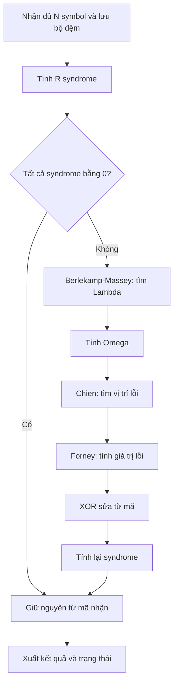

# Các bước mã hóa và giải mã Reed–Solomon

Tài liệu này cụ thể hóa luồng RS trong [README](../README_RS_DE10_Lite.md)
theo cấu hình đã chọn tại [`rs_params.vh`](../rtl/include/rs_params.vh).
Phép toán trên symbol được mô tả trong [gf256.md](gf256.md).
Đây là đặc tả thuật toán để triển khai model và RTL, chưa phải xác nhận các
module hoặc testbench đã được hoàn thành.

## 1. Cấu hình và phạm vi

| Tham số | Giá trị hiện tại |
| --- | --- |
| Trường | GF(256), mỗi symbol 8 bit |
| Đa thức trường `p(u)` | `u^8 + u^4 + u^3 + u^2 + 1`, mã `0x11D` |
| Phần tử nguyên thủy `alpha` | `0x02` |
| Độ dài từ mã `N` | 15 symbol |
| Độ dài dữ liệu `K` | 11 symbol |
| Số parity `R = N - K` | 4 symbol |
| Khả năng sửa lỗi `T = floor(R/2)` | 2 symbol không biết trước vị trí |
| Nghiệm đầu `F = RS_FIRST_ROOT` | 0 |
| Bước số mũ `RS_ROOT_STEP` | 1 |
| Mã cha và số symbol rút ngắn | RS(255,251), bỏ 240 symbol dữ liệu 0 ở đầu |

README chỉ chốt GF(256); các lựa chọn còn lại là mặc định hiện tại của dự
án. Các công thức vị trí và Forney dưới đây dùng bước số mũ bằng 1. Khi đổi
tham số, phải cập nhật đồng bộ model, hệ số, vector và RTL liên quan.

Decoder trong tài liệu xử lý lỗi symbol chưa biết vị trí, chưa bổ sung
erasure. Một symbol có nhiều bit sai vẫn tính là một lỗi symbol. Với mã
hiện tại, khoảng cách tối thiểu là `R + 1 = 5`; bảo đảm khôi phục áp dụng
khi số symbol sai không vượt quá 2.

## 2. Quy ước đa thức và thứ tự hệ số

Byte đầu truyền trước và tương ứng hệ số bậc cao:

```text
m(x) = m[0]*x^(K-1) + ... + m[K-1]
c(x) = c[0]*x^(N-1) + ... + c[N-1]
y(x) = c(x) + e(x)
```

`m` là dữ liệu, `c` là từ mã hợp lệ, `y` là từ mã nhận, `e` là mẫu lỗi.
Trong GF(256), dấu cộng/trừ hệ số đều là XOR; nhân và chia hệ số là phép
toán GF, không phải số học nguyên trên byte.

Để tránh đảo thứ tự khi triển khai, dùng các quy ước mảng sau:

| Mảng | Thứ tự lưu |
| --- | --- |
| `m[i]`, `c[i]`, `y[i]` | Theo thứ tự truyền, hệ số bậc cao trước |
| `g[j]` | Hệ số của `x^(R-j)`, bậc cao trước |
| `S[j]` | Syndrome tại nghiệm thứ `j`, bắt đầu bằng `S[0]` |
| `lambda[j]`, `omega[j]` | Hệ số của `z^j`, bậc thấp trước |

`u` dùng trong đa thức trường bên trong một byte; `x` dùng cho từ mã;
`z` dùng cho syndrome và đa thức định vị lỗi.

## 3. Tạo đa thức sinh

Với cấu hình hiện tại:

```text
g(x) = product từ j=0 đến R-1 của (x + alpha^(F+j))
     = (x + 01)(x + 02)(x + 04)(x + 08)
     = x^4 + 0F*x^3 + 36*x^2 + 78*x + 40
```

Các hệ số hai chữ số trong công thức được viết ở hệ hexadecimal và thuộc
GF(256). Mảng hệ số bậc cao trước là:

```text
g = [01, 0F, 36, 78, 40]
```

Có thể tạo hệ số bằng cách bắt đầu từ đa thức 1 rồi nhân lần lượt với từng
nhân tử. Kiểm tra `g(alpha^(F+j)) = 0` cho mọi `j = 0..R-1` trước khi dùng.

## 4. Mã hóa systematic

### 4.1. Công thức

Thêm `R` vị trí parity ở cuối dữ liệu, tính phần dư đa thức rồi ghép từ mã:

```text
v(x) = x^R * m(x)
p(x) = v(x) mod g(x), với deg(p) < R
c(x) = v(x) + p(x)
```

Trong đặc số 2, cộng phần dư cũng là trừ phần dư. Do đó `c(x)` chia hết cho
`g(x)`, và thứ tự đầu ra là:

```text
c = [m[0], ..., m[K-1], parity[0], ..., parity[R-1]]
```

Phần dư luôn được xuất đủ `R` byte, kể cả các byte đầu bằng 0.

### 4.2. Thuật toán chia đa thức tham chiếu

Đoạn Python này sử dụng `gf_mul` trong [gf256.md](gf256.md):

```python
N, K, R, T = 15, 11, 4, 2
G = [0x01, 0x0F, 0x36, 0x78, 0x40]


def rs_encode(data):
    if len(data) != K or any(not 0 <= a <= 0xFF for a in data):
        raise ValueError("Expected K byte symbols")
    work = list(data) + [0] * R
    for i in range(K):
        feedback = work[i]
        for j in range(R + 1):
            work[i + j] ^= gf_mul(feedback, G[j])
    return list(data) + work[-R:]
```

`feedback` phải lấy trước khi sửa `work[i]`. Mảng `work` bị biến đổi trong
phép chia; phần dữ liệu trả ra phải lấy từ bản gốc. RTL có thể thực hiện
cùng phép toán bằng bộ thanh ghi parity và mạng nhân hệ số cố định.

### 4.3. Rút ngắn mã

Về mặt định nghĩa, thêm 240 byte 0 trước 11 byte dữ liệu để tạo dữ liệu mã
cha RS(255,251), mã hóa rồi bỏ 240 byte 0 đầu từ mã. Vì trạng thái parity
khởi đầu bằng 0, xử lý các byte 0 đầu vẫn giữ trạng thái bằng 0. Do đó có
thể mã hóa trực tiếp 11 byte bằng thuật toán trên và dùng cùng `g(x)`.

Decoder cũng chỉ cần nhận 15 byte thực sự được truyền. Không nhập thêm
240 byte 0 bằng switch và không thêm chúng vào cuối khối.

## 5. Luồng giải mã

Luồng syndrome → Berlekamp–Massey → Chien/Forney → sửa lỗi phù hợp với kiến
trúc HDL được mô tả trong
[MathWorks — RS Decoder](https://www.mathworks.com/help/wireless-hdl/ref/rsdecoder.html).
Trong dự án, tính Omega được trình bày thành một bước riêng:



Các nhánh phát hiện thất bại ở từng bước phải kết thúc với `fail`, không
đưa kết quả vào nhánh thành công của sơ đồ.

## 6. Tính syndrome

Tính đủ `R` giá trị:

```text
S[j] = y(alpha^(F+j)), j = 0..R-1
```

Với mỗi điểm `beta = alpha^(F+j)`, dùng Horner theo thứ tự truyền:

```text
acc = 0
Với i = 0..N-1:
    acc = gf_mul(acc, beta) XOR y[i]
S[j] = acc
```

Nếu tất cả syndrome bằng 0, từ mã nhận thỏa các kiểm tra parity và có thể
đi thẳng tới đầu ra. Điều đó không chứng minh nó trùng từ mã gốc khi số
lỗi vượt giới hạn bảo đảm.

Đa thức syndrome dùng trong các bước tiếp theo có thứ tự bậc thấp trước:

```text
S(z) = S[0] + S[1]*z + ... + S[R-1]*z^(R-1)
```

Không bỏ `S[0]` hoặc đổi thành chuỗi bắt đầu tại `y(alpha^1)`.

## 7. Berlekamp–Massey: tìm Lambda

Nếu có `nu` lỗi tại các chỉ số truyền `i`, định nghĩa:

```text
X_i = alpha^(N-1-i)
Lambda(z) = product trên các vị trí lỗi i của (1 + X_i*z)
          = 1 + lambda[1]*z + ... + lambda[nu]*z^nu
```

Mục tiêu là tìm đa thức có hệ số hằng bằng 1 và bậc `nu`. Dùng phiên bản
Berlekamp–Massey thông thường có phép chia GF; chưa dùng biến thể không
nghịch đảo vì biến thể đó cần theo dõi hệ số chuẩn hóa riêng.

```python
def berlekamp_massey(S):
    if len(S) != R:
        raise ValueError("Expected R syndromes")
    C = [1] + [0] * R
    B = C.copy()
    L, shift, b = 0, 1, 1
    for q in range(R):
        d = S[q]
        for j in range(1, L + 1):
            d ^= gf_mul(C[j], S[q - j])
        if d == 0:
            shift += 1
            continue
        previous = C.copy()
        scale = gf_div(d, b)
        for j in range(R + 1 - shift):
            C[j + shift] ^= gf_mul(scale, B[j])
        if 2 * L <= q:
            L = q + 1 - L
            B = previous
            b = d
            shift = 1
        else:
            shift += 1
    return C[:L + 1], L
```

`d` là discrepancy; `b` lưu discrepancy khác 0 của lần cập nhật bậc gần
nhất. Các phép tính `q`, `L`, `shift` dùng số học nguyên. Các phép tính hệ
số dùng GF. Khi chuyển sang RTL, các cập nhật phải sử dụng đúng bản sao
trước cập nhật, đặc biệt là `previous`.

Với syndrome khác 0, báo thất bại nếu `L = 0`, `L > T` hoặc bậc thực của
đa thức trả về không bằng `L`. Bộ nhớ trung gian của thuật toán trên có
`R+1` hệ số; không tự giới hạn còn `T+1` rồi làm mất trường hợp cần báo lỗi.

## 8. Tính đa thức đánh giá lỗi Omega

Phương trình khóa với quy ước đã chọn là:

```text
Omega(z) = [S(z) * Lambda(z)] mod z^R
omega[q] = XOR của gf_mul(lambda[j], S[q-j])
           với j = 0..min(q,L), q = 0..R-1
```

Phép `mod z^R` chỉ giữ `R` hệ số bậc thấp. Đây là phép cắt bậc của đa thức
theo `z`, không phải phép rút gọn một byte theo `p(u)`.

Với mẫu lỗi hợp lệ trong giới hạn, `deg(Omega) < L`. Có thể dùng điều kiện
các hệ số `omega[L..R-1]` bằng 0 như một kiểm tra bổ sung; đây không phải
bằng chứng dữ liệu khôi phục đúng trong mọi trường hợp vượt giới hạn.

## 9. Chien search: tìm vị trí lỗi

Duyệt các vị trí thực sự được truyền:

```text
Với i = 0..N-1:
    X_i = alpha^(N-1-i)
    z_i = inverse(X_i)
    Nếu Lambda(z_i) = 0:
        ghi lại (i, X_i, z_i)
```

Khi đánh giá mảng hệ số bậc thấp trước bằng Horner, phải đọc mảng từ hệ số
bậc cao nhất về hệ số hằng. Với mã hiện tại, vị trí 0 ứng với số mũ 14,
vị trí 14 ứng với số mũ 0. Số mũ âm được rút gọn modulo 255.

Chỉ chấp nhận khi tìm được đúng `L` vị trí phân biệt trong `0..N-1`.
Nếu dùng lõi Chien quét cả mã cha, vị trí mã cha `j` tương ứng vị trí truyền
`i = j - 240`. Nghiệm thuộc 240 vị trí đã bỏ ở đầu phải bị từ chối. Không
cộng 240 vào số mũ `N-1-i` khi đang dùng chỉ số của từ mã rút ngắn.

## 10. Forney: tính giá trị lỗi

Đạo hàm hình thức trong đặc số 2 chỉ giữ các số hạng có bậc lẻ:

```text
Lambda'(z) = lambda[1] + lambda[3]*z^2 + lambda[5]*z^4 + ...
```

Với `z_i = X_i^(-1)` và bước số mũ bằng 1, công thức phù hợp là:

```text
E_i = X_i^(1-F) * Omega(z_i) / Lambda'(z_i)
```

Hệ số phụ thuộc nghiệm đầu cũng có trong cách tính Forney của
[Linux — decode_rs.c](https://raw.githubusercontent.com/torvalds/linux/master/lib/reed_solomon/decode_rs.c):
nguồn đó viết nó dưới dạng `z_i^(F-1)`, tương đương `X_i^(1-F)`.

**Với `F = 0` hiện tại, phải nhân thêm `X_i`:**

```text
E_i = gf_mul(X_i, gf_div(Omega(z_i), Lambda'(z_i)))
```

Không bỏ hệ số `X_i` bằng cách dùng công thức của cấu hình nghiệm đầu
`F = 1`. Dấu trừ của công thức trên trường tổng quát trùng dấu cộng trong
đặc số 2. Nếu `Lambda'(z_i) = 0`, báo thất bại trước khi thực hiện phép chia.

Có thể kiểm tra hệ số vị trí bằng trường hợp một lỗi: `Lambda(z) = 1 + X*z`,
`Omega(z) = E` khi `F = 0`, và `Lambda'(z) = X`. Công thức phải trả về
`X * E / X = E`.

## 11. Sửa lỗi và kiểm tra lại

Sao chép `y` sang bộ đệm ứng viên, sau đó cập nhật các vị trí lỗi:

```text
corrected[i] = y[i] XOR E_i
```

Các vị trí còn lại được giữ nguyên. Lỗi trong parity cũng phải được sửa.
Tính lại đủ `R` syndrome trên toàn bộ `N` symbol ứng viên. Chỉ chấp nhận nếu
tất cả bằng 0 và các bước kiểm tra trước đó đều đạt.

Kết quả toán học gồm từ mã đã hiệu chỉnh `N` symbol; `K` symbol đầu là dữ
liệu khôi phục. Khi triển khai cổng RTL, phải ghi rõ module xuất `K` byte
dữ liệu hay cả `N` byte, và cung cấp đường đọc đủ từ mã nếu checker cần nó.

Báo `fail` khi phát hiện bậc Lambda không hợp lệ, thiếu nghiệm trong vùng
truyền, mẫu số Forney bằng 0 hoặc syndrome sau sửa còn khác 0. Khi thất bại,
không trình bày bộ đệm ứng viên như dữ liệu đã sửa thành công.

Với hơn `T` lỗi, decoder có thể báo thất bại hoặc giải mã nhầm sang một từ
mã khác. Kiểm tra syndrome sau sửa không loại bỏ hoàn toàn khả năng giải
mã nhầm. Trong demo, checker phải đối chiếu với bản gốc đã lưu.

## 12. Ví dụ mã hóa và sửa hai lỗi

Tất cả các byte dưới đây viết ở hệ hexadecimal, chỉ số vị trí bắt đầu từ 0.

```text
Dữ liệu, 11 byte:
00 01 02 03 04 05 06 07 08 09 0A

Parity:
C0 8F 28 6C

Từ mã, 15 byte:
00 01 02 03 04 05 06 07 08 09 0A C0 8F 28 6C

Tạo lỗi: XOR 55 vào vị trí 0, XOR A6 vào vị trí 14.
Từ mã nhận:
55 01 02 03 04 05 06 07 08 09 0A C0 8F 28 CA

S[0..3] = [F3, 60, 0D, 24]
Lambda(z) = 01 + 12*z + 13*z^2
Omega(z)  = F3 + 10*z
Lambda'(z) = 12
```

| Chỉ số lỗi `i` | `X_i` | `z_i` | Giá trị lỗi Forney `E_i` |
| --- | --- | --- | --- |
| 0 | `13` | `58` | `55` |
| 14 | `01` | `01` | `A6` |

Sau XOR sửa lỗi, từ mã trở lại đúng chuỗi đã mã hóa; syndrome sau sửa là
`[00, 00, 00, 00]`, và 11 byte đầu trùng dữ liệu gốc. Ví dụ này kiểm tra cả
lỗi đầu khối dữ liệu và lỗi cuối khối parity.

## 13. Ánh xạ sang module và điều khiển

| File dự kiến | Trách nhiệm |
| --- | --- |
| `rtl/rs_encoder/rs_encoder.v` | Nhận `K` symbol, tính parity, xuất từ mã |
| `rtl/rs_decoder/syndrome.v` | Tính syndrome trước và sau sửa |
| `rtl/rs_decoder/berlekamp_massey.v` | Tìm Lambda và bậc `L` |
| `rtl/rs_decoder/error_evaluator.v` | Tính Omega |
| `rtl/rs_decoder/chien_search.v` | Tìm các vị trí và giá trị `X_i` hoặc `z_i` |
| `rtl/rs_decoder/forney.v` | Tính giá trị lỗi |
| `rtl/rs_decoder/error_corrector.v` | Tạo từ mã ứng viên bằng XOR |
| `rtl/rs_decoder/rs_decoder.v` | Điều phối các bước và kiểm tra thất bại |
| `rtl/memory/data_buffer.v` | Lưu dữ liệu và từ mã |
| `rtl/demo/result_checker.v` | Đối chiếu kết quả với bản gốc trong demo |

FSM decoder có thể đi theo các pha `LOAD → SYNDROME → BM → OMEGA → CHIEN
→ FORNEY → CORRECT → VERIFY → OUTPUT → DONE`. Đây là gợi ý tổ chức, không
phải cam kết độ trễ. Trường hợp syndrome bằng 0 có thể bỏ qua các pha sửa.

Theo README, chỉ nhận hoặc xuất một symbol ở cạnh lên khi `valid && ready`.
Nguồn giữ dữ liệu ổn định nếu đầu ra đang bị chặn; bộ đếm symbol chỉ tăng
khi bắt tay thành công. Cần ghi rõ thời điểm chấp nhận `start`, phát `done`,
hiệu lực của `fail` và hành vi reset trong hợp đồng của từng module.

## 14. Kiểm chứng khi triển khai

- Kiểm tra các nghiệm của `g(x)`, parity và toàn bộ từ mã với model độc lập.
- Kiểm tra tính tương đương giữa mã hóa trực tiếp và mã hóa mã cha có
  240 byte 0 ở đầu; syndrome của từ mã hợp lệ phải bằng 0.
- Không lỗi: giữ nguyên cả dữ liệu và parity.
- Một lỗi: quét từng vị trí `0..N-1`, gồm cả dữ liệu và parity, với các
  giá trị lỗi khác 0.
- Hai lỗi: thay đổi vị trí và giá trị; có trường hợp `S[0] = 0` nhưng các
  syndrome khác không đồng thời bằng 0, để tránh bỏ qua lỗi sai.
- Dùng dữ liệu toàn 0, dữ liệu có byte 0 ở đầu và dữ liệu ngẫu nhiên.
- Trên `T` lỗi: ghi nhận cả báo thất bại và giải mã nhầm; không yêu cầu
  mọi mẫu đều báo `fail`.
- Với RTL, kiểm tra reset giữa khối, khoảng nghỉ đầu vào và chặn đầu ra;
  đối chiếu số lượng, thứ tự symbol và trạng thái hoàn tất.

Các ví dụ số và mã minh họa phục vụ kiểm tra thuật toán. Kết quả của model
không thay thế cho mô phỏng RTL, kiểm tra timing hoặc kiểm chứng trên board.
