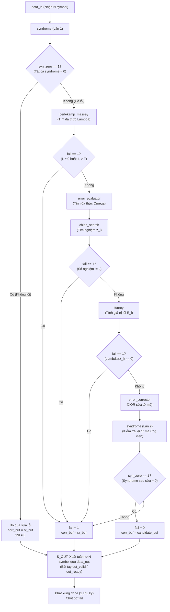

# Bộ giải mã Reed–Solomon RS(15,11) — `rs_decoder`

Tài liệu thiết kế, giao diện cổng và luồng điều khiển của module bộ giải mã Reed–Solomon (`rs_decoder.v`) triển khai trên FPGA DE10-Lite theo đặc tả trong [README_RS_DE10_Lite.md](../../README_RS_DE10_Lite.md) và các tài liệu thuật toán liên quan.

---

## 1. Tổng quan và thông số cấu hình

`rs_decoder` là khối điều phối cấp cao nhất (Top Decoder Controller) của phần giải mã, chịu trách nhiệm tích hợp toàn bộ chuỗi thuật toán từ tính syndrome, tìm phương trình khóa, đánh giá vị trí/giá trị lỗi đến sửa lỗi và kiểm tra lại.

| Thông số | Giá trị | Ý nghĩa |
|---|---|---|
| Kích thước trường $m$ | `8` bit | Hoạt động trong $\text{GF}(256)$, mỗi symbol là 1 byte (`0x00` .. `0xFF`) |
| Đa thức trường $p(u)$ | `9'h11D` | $p(u) = u^8 + u^4 + u^3 + u^2 + 1$ (phần thấp `8'h1D`) |
| Phần tử nguyên thủy $\alpha$ | `8'h02` | $\alpha = u$, chu kỳ 255 |
| Độ dài từ mã $N$ | `15` symbol | Rút ngắn từ mã cha RS(255,251) |
| Độ dài dữ liệu $K$ | `11` symbol | Số symbol dữ liệu gốc |
| Số parity $R = N - K$ | `4` symbol | Số symbol kiểm tra redundancy |
| Khả năng sửa lỗi $T$ | `2` symbol | Sửa bảo đảm tối đa 2 symbol lỗi bất kỳ trong từ mã 15 bytes |
| Nghiệm đầu $F$ | `0` | Nghiệm đầu của $g(x)$ là $\alpha^0 = 0x01$ |
| Bước số mũ | `1` | Các nghiệm $g(x)$ là $\alpha^0, \alpha^1, \alpha^2, \alpha^3$ |

---

## 2. Kiến trúc khối và luồng điều phối

Module `rs_decoder` kết nối và điều phối các khối con chuyên biệt nằm trong thư mục `rtl/rs_decoder/`:



### Các khối con tích hợp:
1. **`syndrome` (`syndrome.v`)**: Tính 4 syndrome $S[0..3]$ từ chuỗi $N=15$ symbol bằng thuật toán Horner. Tái sử dụng để kiểm tra lại từ mã sau sửa.
2. **`berlekamp_massey` (`berlekamp_massey.v`)**: Tìm đa thức định vị lỗi $\Lambda(z)$ bậc $L \le 2$ trong 8 chu kỳ xung nhịp.
3. **`error_evaluator` (`error_evaluator.v`)**: Tính đa thức đánh giá lỗi $\Omega(z) = [S(z) \cdot \Lambda(z)] \pmod{z^R}$.
4. **`chien_search` (`chien_search.v`)**: Quét nghiệm trong phạm vi các vị trí truyền thực tế $i = 0..N-1$ ($X_i = \alpha^{14-i}, z_i = X_i^{-1}$).
5. **`forney` (`forney.v`)**: Tính giá trị lỗi với công thức phù hợp cho $F=0$: $E_i = X_i \cdot \frac{\Omega(z_i)}{\Lambda'(z_i)}$.
6. **`error_corrector` (`error_corrector.v`)**: XOR giá trị lỗi vào các symbol tương ứng trong từ mã nhận: $c_i = y_i \oplus E_i$.

---

## 3. Bảng đặc tả giao tiếp cổng (Port Specifications)

```verilog
module rs_decoder (
    input  wire                 clk,
    input  wire                 rst_n,

    input  wire                 start,

    input  wire [7:0]           data_in,
    input  wire                 in_valid,
    output wire                 in_ready,

    output reg  [7:0]           data_out,
    output reg                  out_valid,
    input  wire                 out_ready,
    output reg                  out_last,

    output wire                 busy,
    output reg                  done,
    output reg                  fail
);
```

### Chi tiết tín hiệu:

| Tên cổng | Hướng | Độ rộng | Mô tả chức năng |
|---|:---:|:---:|---|
| `clk` | Input | 1 bit | Clock hệ thống 50 MHz (chu kỳ 20 ns) |
| `rst_n` | Input | 1 bit | Reset bất đồng bộ, tích cực mức thấp (nối từ `reset_sync`) |
| `start` | Input | 1 bit | Xung tích cực cao 1 chu kỳ để bắt đầu giải mã khối mới. Chỉ chấp nhận khi `busy = 0`; bị bỏ qua nếu đưa vào lúc đang bận |
| `data_in[7:0]` | Input | 8 bit | Symbol nhận đưa vào. Thứ tự truyền: $y[0]$ (hệ số $x^{N-1}$) truyền đầu tiên, $y[N-1]$ truyền cuối cùng |
| `in_valid` | Input | 1 bit | Báo dữ liệu tại `data_in` hợp lệ |
| `in_ready` | Output | 1 bit | Báo decoder sẵn sàng nhận symbol. Chỉ bằng `1` trong pha nhận (`busy = 1`), bằng `0` khi IDLE hoặc đang tính toán |
| `data_out[7:0]` | Output | 8 bit | Symbol từ mã xuất ra sau khi giải mã ($K$ symbol dữ liệu gốc theo sau bởi $R$ symbol parity) |
| `out_valid` | Output | 1 bit | Báo dữ liệu tại `data_out` hợp lệ |
| `out_ready` | Input | 1 bit | Phản hồi sẵn sàng từ phía nhận. Khi `out_valid = 1` mà `out_ready = 0`, dữ liệu `data_out` được giữ cố định (backpressure) |
| `out_last` | Output | 1 bit | Tích cực mức cao đúng bằng `1` tại symbol thứ $N$ ($N = 15$) |
| `busy` | Output | 1 bit | Báo decoder đang bận xử lý. Bằng `1` từ khi chấp nhận `start` đến khi hoàn tất |
| `done` | Output | 1 bit | Xung tích cực cao 1 chu kỳ ngay sau khi symbol cuối cùng được đọc ở đầu ra |
| `fail` | Output | 1 bit | Báo phát hiện lỗi không thể sửa. Hợp lệ cùng lúc với `done` và được chốt giữ nguyên đến lần `start` kế tiếp |

---

## 4. Máy trạng thái hữu hạn (FSM)

FSM của `rs_decoder` hoạt động qua các trạng thái tuần tự:

```text
S_IDLE ──(start)──> S_RECV ──(đủ N byte)──> S_WAIT_SYN1
                                                  │
                 ┌────────────────────────────────┴────────────────────────┐
                 ▼ (syn_zero == 1)                                         ▼ (syn_zero == 0)
            S_OUT_PREP                                                    S_BM
                 ▲                                                         │
                 │ (sau khi chốt fail/corr_buf)                            ▼
                 ├────── S_CHIEN ◄───── S_OMEGA ◄──────────────────────────┘
                 │          │
                 │          ▼
                 ├────── S_FORNEY ───> S_CORRECT ───> S_VERIFY_FEED ───> S_VERIFY_WAIT
                 │                                                            │
                 └────────────────────────────────────────────────────────────┘
```

1. **`S_IDLE`**: Trạng thái nghỉ. Chờ xung `start`. Khi có `start`, khởi động module `syndrome` và chuyển sang `S_RECV`.
2. **`S_RECV`**: Bật `in_ready = 1`. Nhận từng symbol khi `in_valid && in_ready`, lưu vào `rx_buf` và đồng thời nạp vào `syndrome`. Sau khi nhận đủ $N=15$ symbol, chuyển sang `S_WAIT_SYN1`.
3. **`S_WAIT_SYN1`**: Đợi `syndrome` lần 1 hoàn tất.
   * Nếu `syn_zero_out == 1` (không có lỗi): đặt `fail = 0`, sao chép `corr_buf = rx_buf`, nhảy thẳng tới `S_OUT_PREP` (bỏ qua mọi khối sửa lỗi).
   * Nếu `syn_zero_out == 0` (có lỗi): chốt giá trị syndrome vào `syn_latched`, kích hoạt `berlekamp_massey` và sang `S_BM`.
4. **`S_BM`**: Đợi Berlekamp–Massey hoàn thành.
   * Nếu `bm_fail_out == 1` ($L=0$ hoặc $L > T$): đánh dấu `fail = 1`, giữ `corr_buf = rx_buf`, chuyển sang `S_OUT_PREP`.
   * Nếu hợp lệ: chốt $\Lambda(z)$ và bậc $L$, kích hoạt `error_evaluator` sang `S_OMEGA`.
5. **`S_OMEGA`**: Đợi tính xong $\Omega(z)$, chốt kết quả và kích hoạt `chien_search` sang `S_CHIEN`.
6. **`S_CHIEN`**: Đợi Chien Search quét xong 15 vị trí.
   * Nếu `chien_fail_out == 1` (số nghiệm tìm được khác $L$): đánh dấu `fail = 1`, chuyển sang `S_OUT_PREP`.
   * Nếu đủ $L$ nghiệm: chốt mặt nạ lỗi `mask_latched`, kích hoạt `forney` sang `S_FORNEY`.
7. **`S_FORNEY`**: Đợi Forney tính xong giá trị lỗi $E_i$.
   * Nếu `forney_fail_out == 1` ($\Lambda'(z_i) = 0$): đánh dấu `fail = 1`, chuyển sang `S_OUT_PREP`.
   * Nếu thành công: chốt `err_val_latched`, kích hoạt `error_corrector` sang `S_CORRECT`.
8. **`S_CORRECT`**: Đợi bộ sửa lỗi hoàn thành phép tính $c_i = y_i \oplus E_i$, thu được `candidate_buf`. Kích hoạt `syndrome` lần 2 và chuyển sang `S_VERIFY_FEED`.
9. **`S_VERIFY_FEED` & `S_VERIFY_WAIT`**: Nạp tuần tự 15 symbol của `candidate_buf` vào `syndrome` để tính lại.
   * Nếu `syn_zero_out == 1` (từ mã sau sửa thỏa mãn mọi kiểm tra parity): xác nhận sửa thành công, `fail = 0`, `corr_buf = candidate_buf`.
   * Nếu `syn_zero_out == 0` (sau sửa vẫn còn lỗi hoặc giải mã nhầm): đánh dấu `fail = 1`, `corr_buf = rx_buf`.
   * Chuyển sang `S_OUT_PREP`.
10. **`S_OUT_PREP` & `S_OUT`**: Nạp symbol đầu tiên ra `data_out`, kích hoạt `out_valid = 1`. Điều khiển phát đủ 15 symbol qua cơ chế bắt tay với `out_ready`. Tại symbol thứ 15, kích hoạt `out_last = 1`. Khi symbol cuối cùng được đọc, phát xung `done = 1` và quay về `S_IDLE`.

---

## 5. Cơ chế an toàn và xử lý lỗi vượt ngưỡng

- **Fast-path (Không lỗi)**: Khi từ mã nhận nguyên vẹn, decoder bỏ qua hoàn toàn các khối giải phương trình, giảm thời gian xử lý xuống mức tối thiểu (chỉ bằng thời gian nhận $N$ chu kỳ + 1 chu kỳ kiểm tra).
- **Kiểm tra syndrome 2 lần (Hai lớp bảo vệ)**: Khi số symbol lỗi thực tế vượt quá khả năng sửa ($> 2$ lỗi), thuật toán Berlekamp–Massey hoặc Chien Search có thể vô tình tìm ra một từ mã hợp lệ khác ở khoảng cách gần (hiện tượng giải mã nhầm - miscorrection). Bước kiểm tra lại syndrome sau sửa đảm bảo loại bỏ phần lớn các trường hợp này; nếu syndrome sau sửa vẫn khác 0, cờ `fail` lập tức được dựng lên.
- **Tuân thủ hợp đồng giao tiếp khi thất bại**: Khi `fail = 1`, decoder **vẫn xuất đủ $N$ symbol** ra bus dữ liệu nhằm tránh hiện tượng treo (deadlock) bộ đệm FIFO hoặc bộ điều khiển bên ngoài, đồng thời cờ `fail` được giữ ổn định cho đến lần `start` tiếp theo để mạch ngoài nhận biết dữ liệu không đáng tin cậy.

---

## 6. Kết quả kiểm chứng mô phỏng

Module đã được kiểm tra toàn diện bằng testbench [`tb/tb_rs_decoder.v`](../../tb/tb_rs_decoder.v) trên trình mô phỏng Icarus Verilog:

```bash
# Lệnh biên dịch và chạy testbench
iverilog -g2005 -o dec.vvp -I ../rtl/include -I . \
    ../rtl/gf_arithmetic/gf256_mul.v \
    ../rtl/gf_arithmetic/gf256_add.v \
    ../rtl/gf_arithmetic/gf256_inv.v \
    ../rtl/rs_decoder/syndrome.v \
    ../rtl/rs_decoder/berlekamp_massey.v \
    ../rtl/rs_decoder/error_evaluator.v \
    ../rtl/rs_decoder/chien_search.v \
    ../rtl/rs_decoder/forney.v \
    ../rtl/rs_decoder/error_corrector.v \
    ../rtl/rs_decoder/rs_decoder.v \
    tb_rs_decoder.v

vvp dec.vvp
```

### Kết quả đạt được:
- **Tổng số kiểm tra**: **4,465 kiểm tra, 0 lỗi (`[PASS]`)**.
- **Không lỗi**: Khôi phục nguyên vẹn dữ liệu gốc, `fail = 0`.
- **1 lỗi**: Kiểm tra quét toàn bộ 15 vị trí với nhiều biên độ lỗi khác nhau $\rightarrow$ sửa đúng $100\%$.
- **2 lỗi**: Kiểm tra tất cả các cặp vị trí phân biệt $\binom{15}{2} = 105$ cặp (gồm cả trường hợp $S[0] = 0$ khi hai lỗi có biên độ bằng nhau) $\rightarrow$ sửa đúng $100\%$.
- **Lỗi biên**: Lỗi tại vị trí đầu khối (index 0) và cuối khối (index 14) $\rightarrow$ sửa đúng theo ví dụ chuẩn mục 12 tài liệu thuật toán.
- **Vượt quá khả năng sửa (> 2 lỗi)**: Thử nghiệm 300 mẫu lỗi ngẫu nhiên từ 3 đến 4 lỗi $\rightarrow$ toàn bộ 300 trường hợp đều được phát hiện và báo cờ `fail = 1`.
- **Tính trơ với can nhiễu điều khiển**: Thử nghiệm chèn khoảng nghỉ ngẫu nhiên ở đầu vào (`in_valid` ngắt quãng), chặn đầu ra (`out_ready = 0` kéo dài), phát xung `start` khi đang `busy`, và reset giữa chừng ở tất cả các trạng thái hoạt động $\rightarrow$ decoder tự khôi phục về trạng thái chuẩn, không bị treo hoặc sai lệch dữ liệu.

